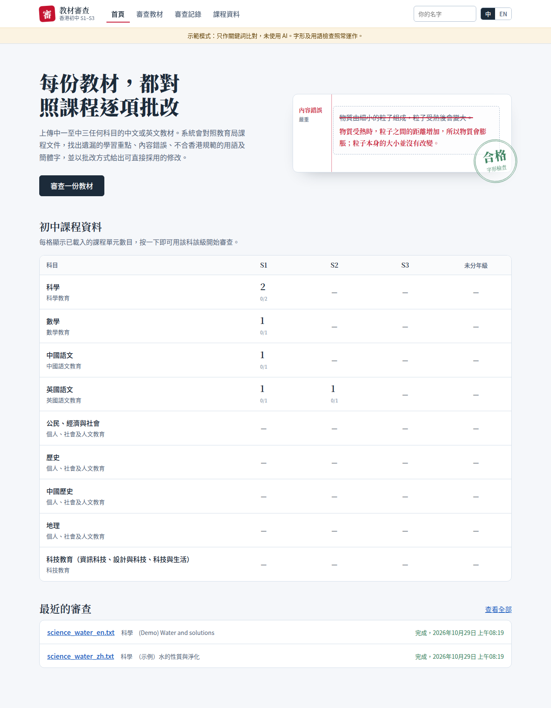
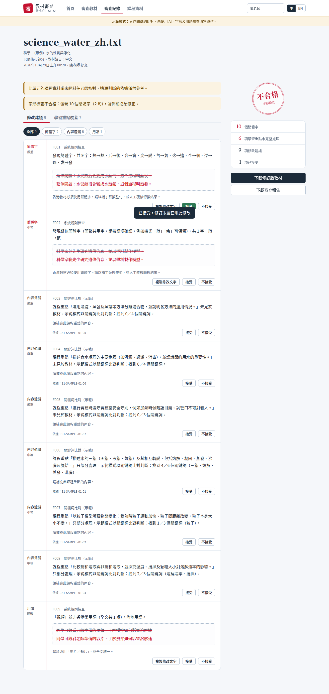
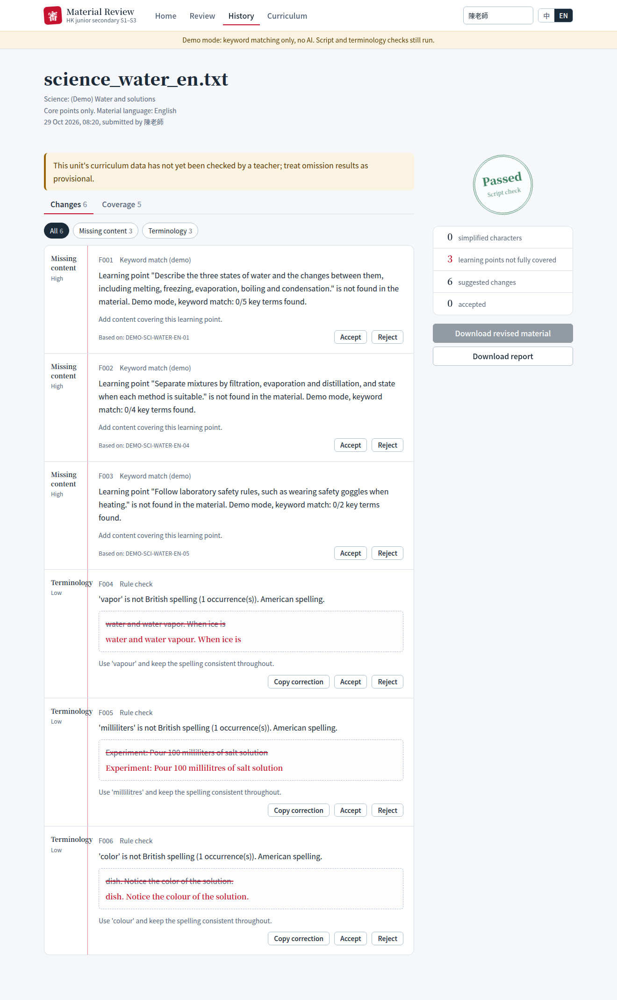

# 香港初中教材 AI 審查平台（中一至中三，全科，中英文）



上傳中一至中三任何科目的中文或英文教材，系統對照教育局課程文件，找出遺漏的學習重點、內容錯誤、不合香港規範的用語（中文：香港用語；英文：英式拼寫）及簡體字，並以老師批改的方式提供可直接採用的修改。介面設中文及英文。需要 Python 3.11 或以上。

| 審查報告（中文） | Review report (English) |
|---|---|
|  |  |

## 支援科目

科目登記在 `data/subjects.json`，附教育局官方文件網址及推行狀況：科學、數學、中國語文、英國語文、公民經濟與社會、歷史、中國歷史、地理、科技教育。每科有自己的審查要求（`app/prompts/profiles.py`），例如數學逐步核對計算、中國語文核對文言注釋、人文學科核對日期及資料來源。

- **內容科目**（科學、數學、人文、科技）：按單元檢查全部核心學習重點，可選擇加入延展部分或只檢查部分重點。
- **語文科**（中國語文、英國語文）：教材通常只針對部分學習重點，老師須勾選要檢查的重點。
- **中英文教材**：自動判斷教材語言；英文教材檢查英式拼寫；英文教材亦可對照中文課程文件（反之亦然），報告會提示跨語言對照。報告說明可選中文或英文，修改文字一律沿用教材的語言。

## 先試用網站（不需 API key）

```bash
pip install -r requirements.txt
DEMO_MODE=true uvicorn app.main:app --port 8000
# 開啟 http://localhost:8000 ，上傳 data/samples/sample_material.txt
```

示範模式只用關鍵詞比對判斷課程覆蓋，不做 AI 審查；字形（簡體字）及用語檢查照常運作。

## 網站功能

- **新審查**：上傳教材、選擇課程單元、決定是否檢查延展部分。審查在背景執行，頁面顯示進度。
- **審查報告**：字形檢查印章（合格／不合格）、課程重點覆蓋清單、以紅筆批改方式顯示的修改建議；每項建議可「接受」或「不接受」，並可複製修改文字。
- **下載**：審查報告（Markdown），以及套用了所有已接受建議的修訂版教材（未能自動套用的會列出）。
- **審查記錄**：所有過往審查。
- **課程資料**：查看由教育局文件擷取的單元，逐項對照原文後按「確認已核對」，記錄核對老師。
- **存取碼**：設定 `ACCESS_CODE` 後，須輸入存取碼才能使用。

## 上線部署

```bash
docker build -t hk-edu-reviewer .
docker run -p 8000:8000 --env-file .env -v $(pwd)/data:/app/data hk-edu-reviewer
```

上線前必須：設定 `ACCESS_CODE`；以 HTTPS 提供服務（例如放在 Caddy 或 Nginx 之後）；定期備份 `data/app.db` 及 `data/curriculum/`。系統只儲存教材的擷取文字及審查結果，不儲存原檔；教材內容會傳送到 Anthropic API 作審查，請按學校的資料政策告知老師。目前所有使用者共用一個存取碼，不設個人帳戶及學校之間的資料分隔，適合單一學校或小規模試用。

上傳教材（PDF / TXT）→ 對照 EDB 課程重點 → 輸出「缺漏提醒、說法修正、香港用語、修改補丁、引文依據」。

## 快速開始

```bash
pip install -r requirements.txt
cp .env.example .env                          # 填入 ANTHROPIC_API_KEY

# 1) 由教育局官方 PDF 建立課程資料庫（網址見 data/subjects.json）
#    有「單元一／Unit 1」標題的文件：自動切分（先預覽）
python -m scripts.extract_curriculum --pdf data/raw/JS_Science_Curriculum_Framework_2025_chinese.pdf \
       --doc SCI-S13-2025 --lang zh --dry-run
python -m scripts.extract_curriculum --pdf data/raw/JS_Science_Curriculum_Framework_2025_chinese.pdf \
       --doc SCI-S13-2025 --lang zh --units 1-6
#    按學習範疇編排的文件（例如中國語文）：手動指定 PDF 頁範圍
python -m scripts.extract_curriculum --pdf data/raw/Junior_Sec_Chi_Lang_Curr_Guide_2023.pdf \
       --doc CHI-S13-2023 --lang zh --manual "1:閱讀:12-15;2:寫作:16-18"
#    → 科任老師核對 data/curriculum/SCI-S13-2025-U0x.json，無誤後把 verified 改為 true

# 2) 建立向量索引並啟動
python -m scripts.ingest_curriculum --rebuild
uvicorn app.main:app --reload

# 開啟 http://localhost:8000
pytest -q                                     # 32 個離線測試（含整個網站流程），不需 API key
```

## 課程資料庫：教育局官方文件

| 文件 | 狀態 | 位置 |
|---|---|---|
| 《科學（中一至中三）課程框架》（2025） | 2025/26–2026/27 學年試行，2027/28 學年起由中一級逐年推行 | `data/subjects.json` 中的 `SCI-S13-2025`（中、英文 PDF） |
| 《科學（中一至中三）》補充文件（2017） | 未參與試行的學校可能仍沿用 | `SCI-S13-2017`（結構不同，需先設定 `unit_heading_regex`） |

2025 框架有 13 個單元。每個單元的「學生應能」欄是學習成果，以 (S) 標示技能類成果，並列出必須安排的「重點實驗」；
**延展部分以藍色斜體標示**，純文字擷取會失去這個資訊，所以擷取程式逐個字體 span 讀取顏色和斜體旗標。
框架建議中一級主要教授生物及地球科學課題，但容許學校調動次序，因此資料庫以「單元」而非「年級」為單位。

擷取由 LLM 負責結構化，但每一項學習成果都要能在 PDF 原文逐字找到；找不到的會標示 ⚠，交老師處理。
所有單元預設 `verified: false`，報告會顯示提示，直至老師核對完成。擴展到其他科目或文件時，在 `subjects.json`
加入該科文件並設定 `unit_heading_regex` 即可。

## 字形檢查（硬性規則）

香港教材不可出現簡體字，所以這一項不經 LLM、不受信心門檻過濾，結果排在報告最前，並以「合格／不合格」顯示。

- 依 OpenCC 字表自動分類：繁體候選不包括自己的字（热→熱）屬**純簡體字**，一律觸發；
  候選包括自己的字（后→後／后、干→幹／乾／干）屬**簡繁共用字**，按詞組語境判斷。
- 共用字在全繁體句子中被觸發（例如「受熱后」、姓氏「范」），以中等嚴重度標示「疑似，請確認」——寧可多報，不可漏報。
- 缺少 OpenCC 時系統拒絕啟動，不會靜默略過。

## 資料夾結構

```
hk-edu-reviewer/
├── app/
│   ├── main.py                  # 網站入口：/ 網頁、/api 介面、背景審查工作、存取碼
│   ├── db.py                    # SQLite：審查記錄、老師回饋
│   ├── static/                  # 前端（HTML／CSS／JS，無需建置；i18n.js 為中英文介面文字）
│   ├── subjects.py              # 科目登記
│   ├── config.py                # 所有參數（模型、chunk 大小、信心門檻…）
│   ├── schemas.py               # Pydantic 模型，同時作為 LLM tool 的 JSON Schema
│   ├── prompts/
│   │   ├── system_prompt.md     # 共用 System Prompt 模板
│   │   ├── profiles.py          # 各科審查要求
│   │   └── templates.py         # coverage / accuracy 兩種任務的 user message
│   └── services/
│       ├── parser.py            # PDF/TXT 解析；處理中文斷行、Big5-HKSCS 編碼
│       ├── chunker.py           # 段落→句子切塊，保留頁碼
│       ├── curriculum_store.py  # Chroma：課程重點索引 + 教材臨時索引
│       ├── script_check.py      # 字形檢查（硬性）：簡體字
│       ├── terminology.py       # 香港用語詞表；官方文件用語自動受保護
│       ├── reviewer.py          # Claude API：強制 tool use 取得結構化輸出 + 重試
│       ├── validation.py        # 防幻覺：引文逐字核對
│       ├── pipeline.py          # 流程編排、進度回報、驗證、去重、排序
│       ├── patcher.py           # 套用已接受的補丁，產生修訂版
│       ├── offline.py           # 離線示範模式
│       └── renderer.py          # JSON → 老師可讀的 Markdown
├── data/
│   ├── subjects.json            # 初中科目登記：教育局官方文件網址、版本、推行狀況、審查模式
│   ├── curriculum/*.json        # 由官方 PDF 擷取的課程資料（DEMO-water.json 只供測試）
│   ├── glossary/                # zh_hk_terms.json（香港用語）、en_british.json（英式拼寫）
│   ├── samples/                 # 含刻意錯誤的示範教材
│   ├── raw/                     # 放置下載的教育局 PDF（不會上傳到 GitHub）
│   └── chroma/                  # 向量庫（自動產生）
├── docs/screenshots/            # README 截圖
├── .github/workflows/tests.yml  # 每次 push 自動執行測試
├── scripts/
│   ├── extract_curriculum.py    # 官方 PDF → 課程 JSON（含延展部分偵測、逐字核對）
│   └── ingest_curriculum.py     # 課程 JSON → Chroma
└── tests/test_offline.py
```

## 流程

```
上傳 → 解析 → 切塊 ─┬─ 規則引擎（確定性用語問題）────────────────────────┐
                     │                                                    │
                     ├─ ① 覆蓋檢查（反向 RAG）                              │
                     │   每個課程重點 → 在「教材」中檢索證據 → LLM 判斷       │
                     │   covered / partial / missing + 補丁                 │
                     │                                                    ├→ 驗證 → 去重 → 排序 → 報告
                     └─ ② 準確性審查（正向 RAG）                            │
                         每批教材片段 → 檢索相關課程重點 → LLM 審查          │
                         概念錯誤 / 不精確 / 語境用語 / 語文 / 安全 ─────────┘
```

## 關鍵設計決定

1. **遺漏偵測用「反向檢索」**。若以教材去檢索課程重點，只會找到教材「有寫」的內容，永遠找不到缺漏。正確做法是以「單元的完整課程重點清單」逐項回頭搜尋教材證據。因此課程重點同時以結構化 JSON（完整清單）及向量（語意檢索）兩種形式存放。
2. **混合檢索**：小型中文 embedding 模型對專有名詞召回不穩，所以每個課程重點附 `key_terms`，先做字面匹配再做語意檢索。
3. **規則引擎與 LLM 分工**：「視頻→影片」這類無歧義替換由詞表處理（零成本、可重現）；「質量」（科學中 = mass，正確）這類語境詞只作提示交給 LLM 判斷。**官方用語優先**：教育局框架本身使用「遺傳信息」「塑料」「數字教育工具」，凡在已載入課程文件出現的詞，詞表規則自動降級，不會把官方用語判為錯誤。
4. **結構化輸出用強制 tool use**，再以 Pydantic 驗證；失敗時把錯誤回饋模型重試一次。
5. **防幻覺**：引文須能在原文逐字找到（容許全半形及空白差異），否則信心 ×0.6；虛構的課程 ID 會被移除並寫入 warnings。
6. **Prompt caching**：所有呼叫共用同一 system prompt，已開啟快取。

## 注意事項

- 請把下載的教育局 PDF 放在 `data/raw/`。此資料夾已列入 `.gitignore`，不會上傳到 GitHub：官方文件的版權屬香港特區政府，應由使用者自行下載。由擷取程式產生的 `data/curriculum/*.json` 含官方文字，如儲存庫設為公開，請先確認使用條款。
- `DEMO-water.json` 只是測試流程用的示範資料，並非教育局原文；正式使用請以擷取程式由官方 PDF 建立。
- 擷取程式未能在開發環境以真實 PDF 測試（無法連線教育局網站），已以合成 PDF 測試延展偵測及逐字核對；首次使用請先跑 `--dry-run` 檢查單元切分及延展標記數目。
- 掃描版 PDF 暫不支援（需加 OCR）。

## 下一步路線圖

1. 建立評估集：20 至 30 份由老師標註過的教材，量度遺漏偵測的 precision / recall，再調 `evidence_top_k`、信心門檻及 prompt。
2. 分析老師回饋（已收集接受／不接受），找出誤報最多的類別，改進詞表及 prompt。
3. 個人帳戶及多校資料分隔；修訂版匯出 Word（含修訂標記）。
4. 擴展至中二、中三及其他科目：只需新增 `data/curriculum/*.json`。
